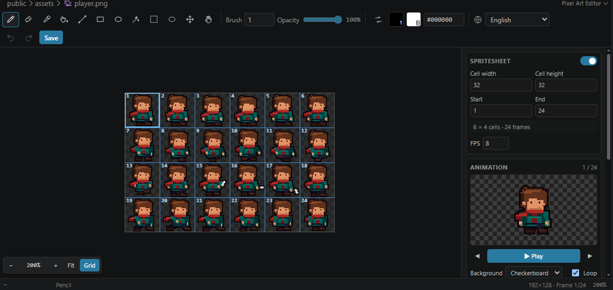

# Pixel Art & Spritesheet Editor

A complete pixel art editor inside VS Code, with drawing and selection tools, undo history, and a spritesheet mode with animation preview.



## Features

- Edit PNG images inside VS Code without leaving the editor.
- Tools: pencil, eraser, eyedropper, fill, line, rectangle, ellipse, magic wand, rectangular selection, elliptical selection, move, and hand.
- Photoshop-style modifiers: Shift for straight lines and proportions, Alt to draw from the center.
- The magic wand selects the contiguous area of the exact color you click.
- With an active selection, drawing, erasing, and fill tools only affect the selected pixels.
- Per-tool properties: brush size, brush shape (square or circle), opacity, shape fill, and fill tolerance.
- Primary and secondary colors. Right-click draws with the secondary color.
- 16-color palette, custom colors, and recent colors.
- Selection with copy, cut, paste, delete, and floating-content move.
- Undo and redo with per-document history.
- Zoom (1x to 64x), panning with Space or the middle mouse button, pixel grid, and transparency background.
- Resize, flip horizontally and vertically, and clear the canvas.
- Spritesheet mode: cell width and height, columns and rows, start and end frame, FPS, and loop playback.
- Animation preview with a checkerboard, theme background, or solid color.
- English and Spanish interface, with a top-bar selector and the `pixelArt.language` setting.
- Saving through VS Code's native save flow (Ctrl+S and Save As).

## Installation

### From a VSIX file

```sh
code --install-extension pixel-art-editor-0.5.2.vsix
```

You can also open the Extensions view, click the three dots, choose **Install from VSIX...**, and select the file.

### From source

```sh
npm install
npm run build
```

Open this folder in VS Code and press F5 to launch the Extension Development Host. The sample PNG is in `dev/sample.png`.

## Usage

- PNG files open with this editor by default. To use the built-in image preview, choose **Reopen Editor With...** on the editor tab.
- Use **Pixel Art: New Sprite** from the Command Palette to create a blank canvas.
- Use **Pixel Art: Open Image with Editor** or the Explorer context menu to open an existing PNG.
- Changes are marked as pending in the tab. Ctrl+S saves the original PNG.
- **Save As** lets you export to another PNG file.
- If you already had another PNG association, VS Code may ask you to choose the default editor. You can change it at any time with **Reopen Editor With... → Configure Default Editor**.
- Change the UI language with the selector in the top bar (Auto, English, or Español) or with the `pixelArt.language` setting.

### Selection and magic wand

- With the **Magic Wand** (`W`), click a pixel to select the entire contiguous area with exactly the same color and transparency.
- **Elliptical Selection** (`Q`) creates circular or elliptical selections; they are stored as a real mask.
- The selection is drawn as marching ants around the actual mask, not a rectangle.
- While a selection is active, the pencil, eraser, line, rectangle, ellipse, and fill tools only affect pixels inside it. The rest of the image stays untouched.
- You can move, copy, cut, paste, or delete the selection, then keep drawing inside it.
- To clear the selection, use **Deselect** or `Ctrl+D`.

### Modifiers

| Combination | Effect |
| --- | --- |
| `Shift` + pencil or eraser | Draws a straight line from the starting point. |
| `Shift` + line | Snaps the line to horizontal, vertical, or a 45° diagonal. |
| `Shift` + rectangle or ellipse | Proportional square or circle. |
| `Alt` + line, rectangle, or ellipse | Draws from the center. |
| `Shift` + rectangular selection | Square selection. |
| `Alt` + rectangular selection | Selection from the center. |
| `Shift` + elliptical selection | Circular selection. |
| `Alt` + elliptical selection | Elliptical selection from the center. |

`Shift` and `Alt` can be combined: for example, `Shift+Alt` with the rectangle draws a centered square.

### Languages

The interface is available in Spanish and English. By default it follows VS Code's language: Spanish when VS Code is in Spanish, and English for any other language. **Auto** restores that behavior, while **English** and **Español** force the app language.

The `pixelArt.language` setting accepts `auto`, `en`, and `es` and is saved in your user settings.

### Spritesheet and animation

1. Turn on the **Spritesheet** switch in the sidebar.
2. Adjust the cell width and height. The grid and frame count update automatically.
3. Set the **start** and **end** frames you want to preview.
4. Press **Play** to watch the animation at the configured FPS. You can enable or disable looping.
5. Use the previous and next frame buttons to inspect the animation frame by frame.

Animation plays only in the preview; the file remains a normal PNG spritesheet.

## Shortcuts

| Action | Shortcut |
| --- | --- |
| Pencil | `B` |
| Eraser | `E` |
| Eyedropper | `I` |
| Fill | `G` |
| Line | `L` |
| Rectangle | `R` |
| Ellipse | `O` |
| Magic wand | `W` |
| Selection | `M` |
| Elliptical selection | `Q` |
| Move | `V` |
| Hand | `H` |
| Brush size | `[` and `]` |
| Swap colors | `X` |
| Zoom | `+`, `-`, mouse wheel |
| Fit to window | `0` |
| Zoom to 100% | `1` |
| Undo / redo | `Ctrl+Z` / `Ctrl+Y` |
| Copy / cut / paste | `Ctrl+C` / `Ctrl+X` / `Ctrl+V` |
| Select all / deselect | `Ctrl+A` / `Ctrl+D` |
| Delete selection | `Del` |
| Nudge selection by 1 pixel | Arrow keys |
| Apply floating content | `Enter` |
| Cancel floating content | `Esc` |
| Pan the canvas | `Space` + drag, or middle mouse button |

On macOS, use `Cmd` instead of `Ctrl`.

## Format and limitations

- The editor works with PNG files and saves lossless PNGs.
- Maximum canvas size: 4096 × 4096.
- One layer per image; there are no layers or onion skin.
- The clipboard is internal to the editor: copy and paste work within the same image.
- History is kept in memory while the editor is open.
- If you undo back to the saved state, VS Code may still show the tab as modified. Save once to clear it; the file contents do not change.
- Spritesheet mode and zoom are not stored inside the PNG; UI settings are kept per panel.

## Publishing to the Marketplace

Publishing to the Visual Studio Marketplace is free. This project uses **Trusted Publishing** with GitHub Actions, so no Azure DevOps account or Personal Access Token is required.

The publisher is `basilio` (set in `package.json`) and the workflow is `.github/workflows/publish.yml`.

1. Open the [publisher management page](https://marketplace.visualstudio.com/manage), select the `basilio` publisher, and open **Trusted Publishing**.
2. Create a policy with these values:
   - **Repository owner:** `alba-97`
   - **Repository:** `pixel-art-spritesheet-editor`
   - **Workflow:** `publish.yml`
   - **Environment:** leave empty
3. In GitHub, open **Actions → Publish Extension → Run workflow** on the `main` branch.

The workflow builds and publishes the extension using GitHub OIDC. The first run publishes the current version; for later releases, bump the version in `package.json`, commit and push, then run the workflow again.

The published ID will be `basilio.pixel-art-editor` and the page will be:

`https://marketplace.visualstudio.com/items?itemName=basilio.pixel-art-editor`

## Development

```sh
npm install
npm run build      # build the extension and webview for production
npm run watch      # rebuild on save
npm run typecheck  # type-check the project
npm run harness    # generate a test page at dev/harness.html
npm run package    # create the .vsix package
```

The test page (`dev/harness.html`) loads the real webview with a simulated host and a sample spritesheet. It is useful for iterating on the interface without launching VS Code. Serve it with:

```sh
node dev/serve.mjs 4173
```

Then open `http://127.0.0.1:4173/dev/harness.html`.

Project structure:

- `src/extension.ts`: activation, commands, and sprite creation.
- `src/pixelEditorProvider.ts`: custom editor, PNG reading and writing, backups.
- `src/protocol.ts`: messages between the extension and the webview.
- `src/hostStrings.ts`: host strings in English and Spanish.
- `webview/main.ts`: editor, tools, selection, history, and preview.
- `webview/i18n.ts`: webview dictionaries and translation helpers.
- `media/editor.html` and `media/style.css`: editor interface.
- `dev/`: test harness, local server, and sample asset generation.

## License

MIT.
